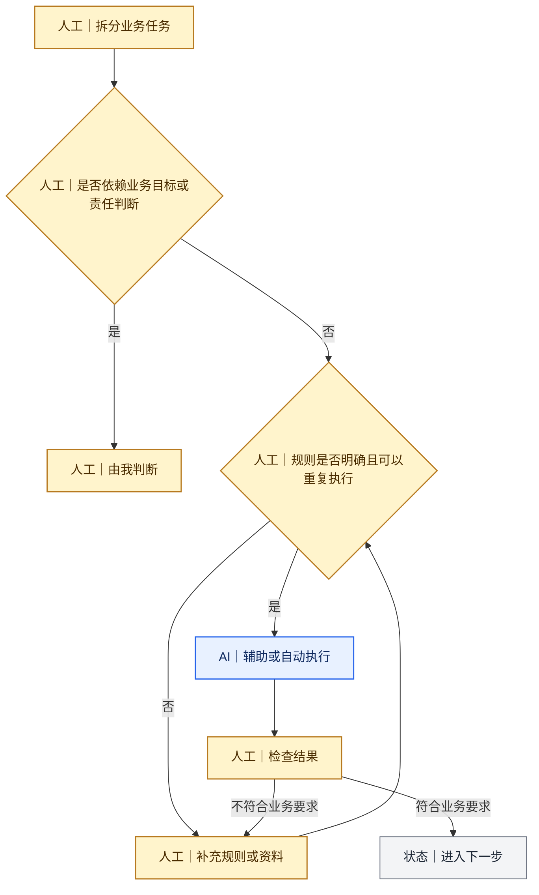
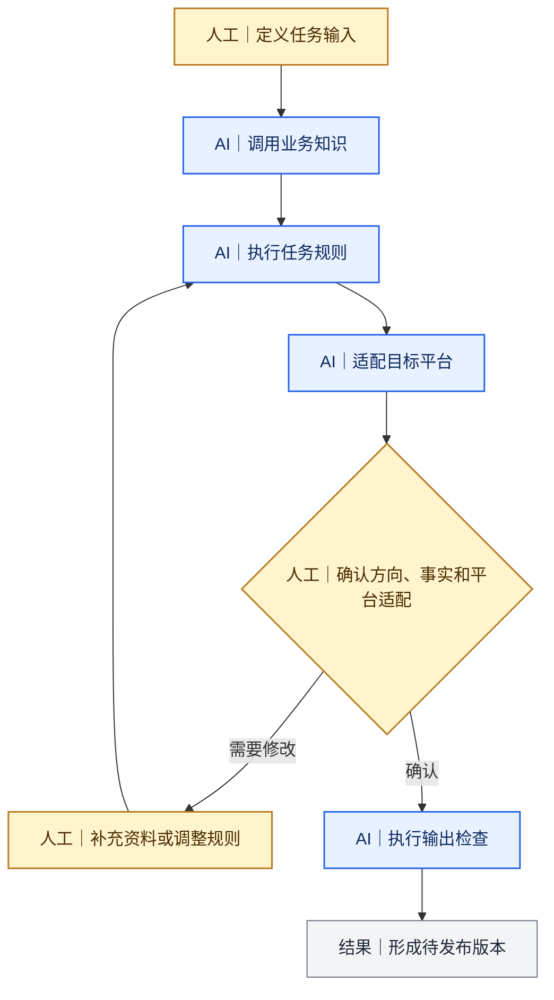
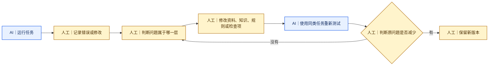
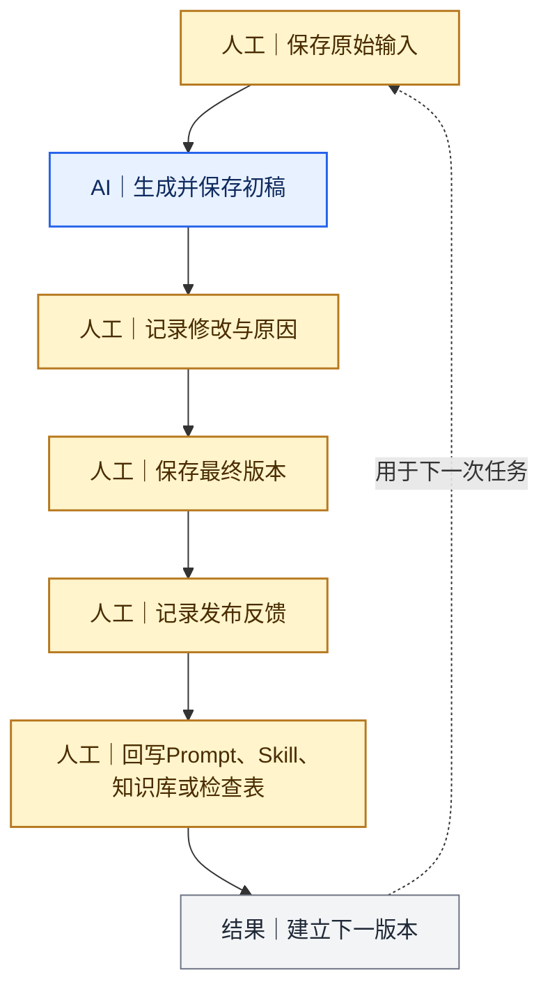
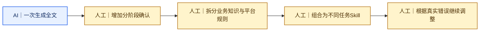
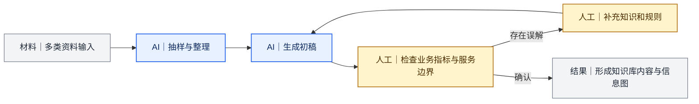
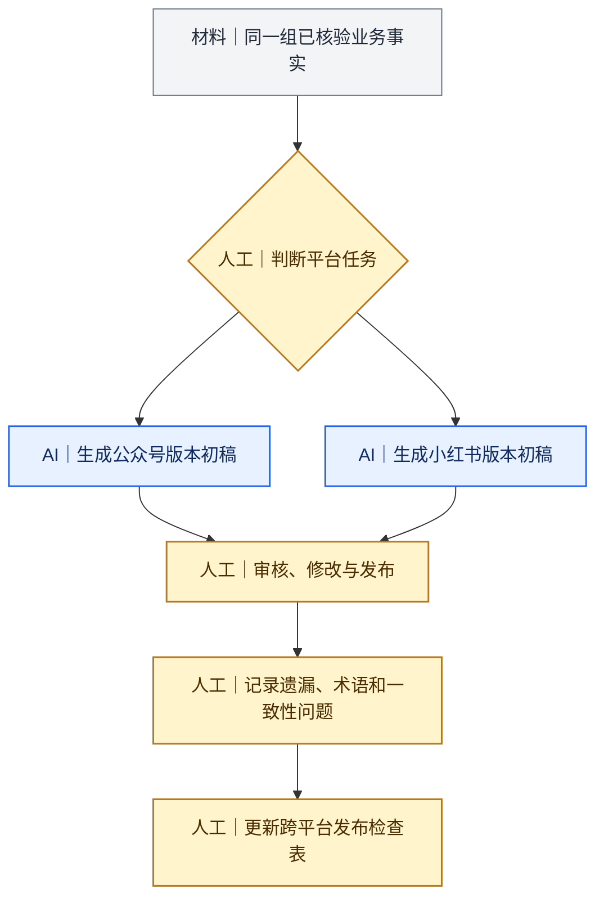

[README.md](https://github.com/user-attachments/files/33802441/README.md)
# 我的AI业务内容生产实践

这个仓库记录我怎样在真实内容业务中定义问题、拆分目标、判断哪些环节可以由AI辅助或自动执行，再通过测试和人工反馈持续调整

仓库内容不重点展示工具技能和生成效果，主要分享我在AI业务中的切入思路、实际操作过程，以及项目运行后仍然需要优化的地方

> 当前版本：v0.9  
> 整理时间：2026年10月

流程图统一使用以下标记：

- 黄色节点：人工判断、人工介入或人工审核
- 蓝色节点：AI执行、AI生成或AI检查
- 灰色节点：输入材料、流程状态或最终输出

## 使用背景

现在已经有很多用于选题、资料整理、文章生产、平台改写、图片制作和视频处理的Skill，也有相对完整的内容生产流程可以参考

我在实际项目中使用这些Skill时发现，通用能力可以完成一部分工作，进入具体业务后仍然需要持续调整。不同业务的目标用户、资料来源、角色关系、指标口径、服务承诺和发布风险并不相同，Skill通常不能直接拿来使用

一个Skill进入业务流程后，我通常还需要完成以下工作：

1. 补充业务背景、专业知识和判断规则
2. 拆分哪些步骤可以交给AI，哪些步骤需要人工介入
3. 设置大纲、事实、数据、平台适配和发布前的人工审核点
4. 记录运行中的错误和人工修改，再把重复问题写回规则

我会在这个仓库中分享自己的实际操作过程，并重点区分三类工作：

| 工作类型 | 在流程中的作用 | 常见内容 |
|---|---|---|
| 可以交给AI | 处理规则明确、重复性较高的工作 | 资料抽取、分类、初稿、格式调整和基础检查 |
| 需要人工介入 | 为任务补充AI无法自行获得的业务判断 | 确定目标、选择资料、解释指标、取舍信息和补充规则 |
| 需要人工审核 | 在关键节点确认结果能否进入下一步 | 核对事实、服务边界、平台适配、品牌、隐私和发布风险 |

我希望这些记录能为使用Skill或搭建工作流的人提供边界参考，了解哪些能力可以复用，哪些内容需要结合业务重新定义，哪些结果仍然要由人负责

## 1. 我怎样定义业务

我不会从“让AI写一篇文章”开始，而是先把本次内容任务放回实际业务场景中

每次开始前，我会确认以下信息：

| 需要确认的内容 | 我关注的问题 |
|---|---|
| 业务场景 | 这项内容属于哪个产品、服务或业务阶段 |
| 目标用户 | 谁会使用这项内容，他正在处理什么问题 |
| 内容任务 | 这次需要解释、比较、提醒、回答还是帮助用户做决策 |
| 输入资料 | 可以使用哪些业务资料、公开来源、用户反馈和数据 |
| 输出形式 | 最终需要公众号文章、小红书笔记、知识库、图卡还是视频脚本 |
| 限制条件 | 哪些内容不能推断，哪些信息不能公开，哪些表述不能承诺 |
| 人工责任 | 哪些判断需要我确认，哪些结果需要我最终审核 |

例如，在Deal站内容中，我定义的任务不是“介绍一个网站”，而是帮助卖家了解网站定位、近期发布内容、服务条件和适用限制，再决定是否适合自己的产品

业务任务确认后，我才开始选择资料和设计AI处理步骤

## 2. 我怎样拆分业务目标并确认可自动化部分

我会先把一个内容任务拆成多个动作，再判断每个动作属于业务判断、重复执行，还是两者共同完成

我的拆分原则是：AI处理资料量大、规则明确、可以重复检查的工作；我保留业务目标、事实边界、信息取舍、风险判断和最终发布决定

| 操作环节 | AI可以处理的部分 | 我保留的部分 |
|---|---|---|
| 需求整理 | 归纳资料、整理问题、列出缺失信息 | 确认真实业务目标和任务优先级 |
| 资料处理 | 搜索、转录、抽取、分类、汇总 | 判断来源是否可信、数据口径是否可用 |
| 内容策划 | 生成大纲和不同结构方案 | 选择主线、重点和信息顺序 |
| 内容生产 | 生成初稿、改写、压缩和格式整理 | 纠正业务角色、指标、流程和承诺错误 |
| 平台适配 | 按规则调整长度、结构和载体 | 判断不同平台的用户任务和账号身份 |
| 发布检查 | 执行术语、格式和一致性检查 | 核对事实、品牌、版权、隐私和风险 |
| 数据整理 | 汇总发布数据和用户反馈 | 解释数据、判断样本和确定调整方向 |

## 3. 我怎样建设自动化部分

确定可以由AI处理的部分后，我会把所需信息和规则拆开，不把所有要求都放进一份提示词

我目前使用六层结构：

1. **任务输入**：本次要处理的对象、目标用户、原始资料和交付形式
2. **业务知识**：业务角色、服务流程、指标定义、适用条件和承诺边界
3. **任务规则**：需要完成的步骤、信息结构和禁止事项
4. **平台规则**：公众号、小红书、知识库等渠道各自的结构和表达要求
5. **人工确认点**：大纲、正文、标题、视觉和发布前需要我确认的节点
6. **输出检查**：事实、术语、数据、品牌、语言、隐私和跨载体一致性

我最开始使用一份Prompt直接生成正文和标题。实际使用后，我增加了大纲确认、正文确认和标题确认，再把业务知识、平台规则和检查项拆成可以分别维护的Prompt、参考文件和Skill

## 4. 我怎样调优自动化流程

我不会只修改一次输出。遇到问题时，我先判断错误来自哪一层，再决定修改资料、业务知识、任务规则、平台规则或检查项

| 出现的问题 | 我判断的原因 | 我的调整位置 |
|---|---|---|
| AI误解业务指标 | 缺少指标产生过程和使用条件 | 补充业务知识 |
| 文章方向与目标不一致 | 生成前没有确认主线 | 增加大纲确认点 |
| 公众号转小红书后只剩摘要 | 只调整长度，没有重新定义平台任务 | 修改平台适配规则 |
| 内容保留结论但删掉限制条件 | 跨载体检查不完整 | 增加结论与免责声明绑定检查 |
| 品牌名、术语或英文拼写不一致 | 发布前缺少专项检查 | 增加术语与语言检查 |

调优时，我会区分一次性内容错误和可重复出现的问题。一次性错误只修改当前内容；重复出现或风险较高的问题会进入长期规则

## 5. 我怎样记录和迭代

每次重要任务完成后，我会保存原始输入、中间版本、人工修改和最终输出，避免只留下最后一篇文章

一条完整记录包括：

- 业务目标、目标用户和发布平台
- 原始资料、数据口径和已知限制
- 当次调用的Prompt、Skill、参考文件和版本
- AI生成的初稿和暴露的问题
- 我修改的内容、判断依据和修改原因
- 最终交付物、发布链接和可用反馈
- 本次问题回写到哪个规则或检查表
- 下一次需要继续验证的内容

我会保留旧版本，并记录修改时间、触发问题、影响范围和验证结果。这样可以回查某条规则为什么加入，也可以判断新版本是否解决了原来的问题

## 6. 案例

### 案例一：从一份Prompt到多平台内容能力体系

我最初使用一份Prompt生成公众号正文和标题，后来增加大纲、正文和标题三个确认阶段

当公众号、小红书和知识库开始同时生产内容后，我把通用写作、业务知识、平台规则和发布检查拆开维护，再根据任务组合使用

这个案例主要记录Prompt 1.0、2.0、小红书转换版本，以及这些版本怎样继续沉淀为Skill和检查表

### 案例二：Deal站业务知识库内容生产

我将网站公开内容、第三方流量资料、平台服务条件和近期发布样本分别整理，再让AI完成抽样、提取、分类和初稿生成

AI第一次输出时误解了部分业务指标。我补充指标产生过程、决策用途和限制条件，再重新生成网站介绍、投放指南和信息图

这个案例保留了前五页共75篇近期内容的采样记录、原始资料、修改过程和最终交付物

### 案例三：同一主题适配公众号与小红书

我使用同一组Slickdeals业务事实，分别制作公众号文章和小红书图文

公众号版本保留等级、声望值、Deal记录、品类和近期状态之间的完整判断过程。小红书版本围绕一个问题重新取材，并将信息拆成短正文和7张图卡

发布后，我发现小红书版本弱化了部分限制条件，公众号版本也存在术语和拼写问题。我将这些问题加入跨平台发布检查表

