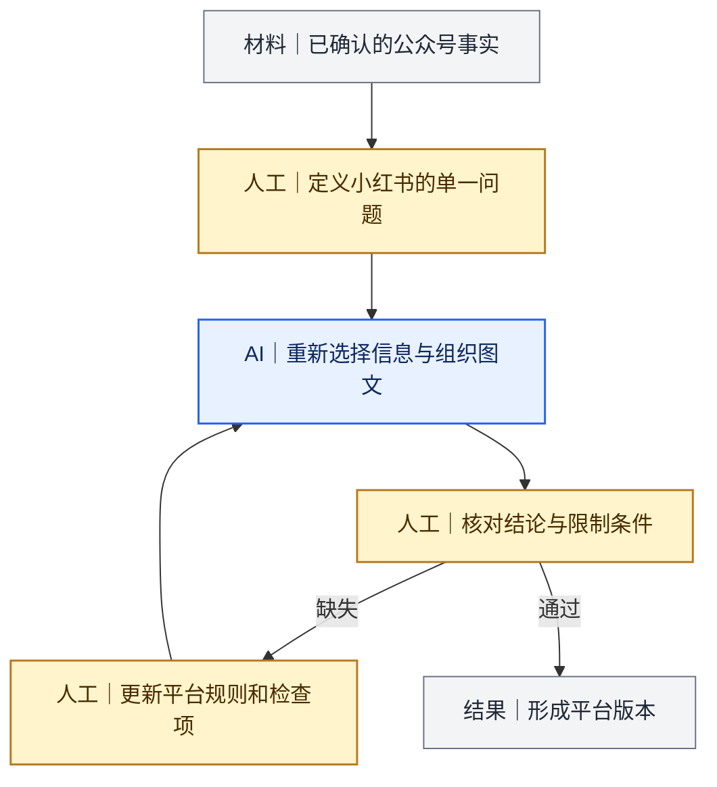

# 案例一：从一次文章Prompt到多平台内容能力体系

[返回 Docs 导航](../README.md)

## 项目背景

我最初希望解决跨境电商平台内容生产中资料分散、人工处理步骤多，以及公众号、小红书和业务知识库无法共用同一写法的问题。

最开始，我把写作要求集中在一份Prompt里，希望AI直接生成正文和标题。实际使用后，我发现AI可以执行写作格式，却不能自动理解业务指标、判断来源是否适用，也不能替我决定不同平台的内容任务。

## 版本怎样演进

| 阶段 | 当时的做法 | 暴露的问题 | 我的调整 |
|---|---|---|---|
| 公众号Prompt 1.0 | 输入意图和资料后，一次生成正文与标题 | 人工介入晚，方向错误后返工较大 | 增加分阶段确认 |
| 公众号Prompt 2.0 | 先确认大纲，再写正文，最后生成标题 | 通用写作、业务知识和平台规则仍混在一起 | 拆分不同能力层 |
| 小红书转换0.5—1.0 | 从公众号内容生成短文、标题和标签 | 机械压缩会丢失平台任务和限制条件 | 按一个问题重新取材 |
| Skill与检查表 | 把稳定步骤、知识和检查项模块化 | 真实错误仍会暴露新缺口 | 保留人工审核和版本回写 |

## 我拆出的能力层

1. 通用写作与事实要求；
2. 跨境电商业务知识和平台边界；
3. 公众号内容生产规则；
4. 小红书内容转换规则；
5. 知识库研究与写作规则；
6. 视觉和发布检查；
7. 人工确认与版本回写。

拆分后，我不再用一份Prompt包办所有任务。业务知识可以更新而不改变写作流程，平台规则也可以单独调优。

## 一次真实的调整

早期小红书规则更偏向缩短正文、增加标题和标签。实际发布后，我发现这种做法容易出现两个问题：一是只剩公众号摘要，二是结论保留了，但限制条件在压缩时被删掉。

我的调整是先重新确认小红书版本要回答的单一问题，再从已核验事实中重新取材，并增加“结论与限制条件同时保留”的检查项。

## 这个案例形成的公开资产

- 公众号Prompt 1.0和2.0的版本演进逻辑；
- 小红书转换0.5和1.0的调整逻辑；
- 业务知识、平台规则、任务规则和检查项的拆分方式；
- 大纲、正文、标题、视觉和发布前的人工确认点；
- 将发布问题回写到Prompt、Skill和检查表的方法。

完整Prompt和Skill源文件保留在内部档案中。公开页面只展示结构、修改原因和经过脱敏的片段。

## 延伸阅读

- [我怎样拆分任务并判断能否交给AI](../methods/02-task-decomposition.md)
- [我怎样建设和调优自动化部分](../methods/03-automation-build-and-tuning.md)

