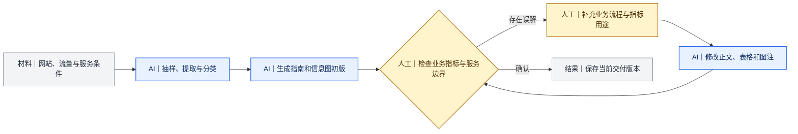

# 案例二：Deal站投放知识库——从资料整理到业务纠错

[返回 Docs 导航](../README.md)

## 项目任务

我需要为一个海外Deal站整理平台介绍和投放指南，帮助卖家判断网站是否适合自己的产品，并了解不同代发服务的条件。

这不是单纯的资料摘要。网站公开内容、第三方流量资料和平台提供的代发条件分别回答不同问题，不能互相替代。

## 输入怎样分开处理

| 资料 | 用途 | 不能直接推出什么 |
|---|---|---|
| 网站近期公开内容 | 判断近期发帖偏好和产品适配 | 不能代表销量或长期整体表现 |
| 第三方流量资料 | 提供站点流量背景 | 不能当作官方后台数据 |
| 平台服务条件 | 说明价格、接单时间、历史表现和限制 | 不能用网站内容补齐未公开条件 |
| 本人的业务知识 | 解释订单、代发人、编辑和发布之间的关系 | 不替代需要统计验证的因果结论 |

## 执行过程

AI读取流量资料，抽取网站前五页共75篇近期内容，整理代发条件，并生成文章和信息图初版。我负责定义用户要解决的问题、解释业务指标、检查服务边界并提出修改。

## 初版出现了什么问题

初版主要强调“上帖率不保证发布”和“内容占比不代表销量”。这些限制并非错误，但只保留了风险提示，没有解释指标怎样产生、用户为什么要看。

我补充了两项业务判断：

1. 历史上帖率来自用户下单、代发人提交、编辑选帖并成功发布后的历史结果；它可以作为选择参考，但不是本次发布承诺。
2. 近期类目占比用来判断网站发帖偏好和产品适配，不用来说明销量。

## 调整前后

| 调整对象 | 初版侧重 | 调整后侧重 |
|---|---|---|
| 历史上帖率 | 只强调不保证发布 | 先解释形成过程和决策用途，再说明不确定性 |
| 代发人比较 | 避免根据单一比例作判断 | 将历史结果与价格、时间和其他限制一起比较 |
| 类目占比 | 强调不能代表销量 | 先用于判断近期偏好和产品适配，再说明样本限制 |
| 信息图 | 简短免责提示 | 让图中文字与正文使用同一业务定义 |

## 哪些内容没有让AI猜测

- 隐藏或未展开的服务条件；
- 无法识别的截图图标；
- 网站发过某类商品是否等于某个代发服务一定接单；
- 历史表现与合作关系之间未经统计验证的量化因果；
- 这份内容是否带来客户、订单或收入。

## 这个案例保留了什么记录

- 网站前五页75篇近期内容的采样记录；
- 第三方流量资料及其时间和口径；
- 服务条件资料；
- 初版问题与人工修改意见；
- 修改后的正文和信息图；
- 输入、过程与交付文件之间的对应关系。

公开仓库不上传未脱敏原始截图、客户资料和内部服务信息。

## 延伸阅读

- [我怎样定义业务问题](../methods/01-business-definition.md)
- [我怎样建设和调优自动化部分](../methods/03-automation-build-and-tuning.md)

