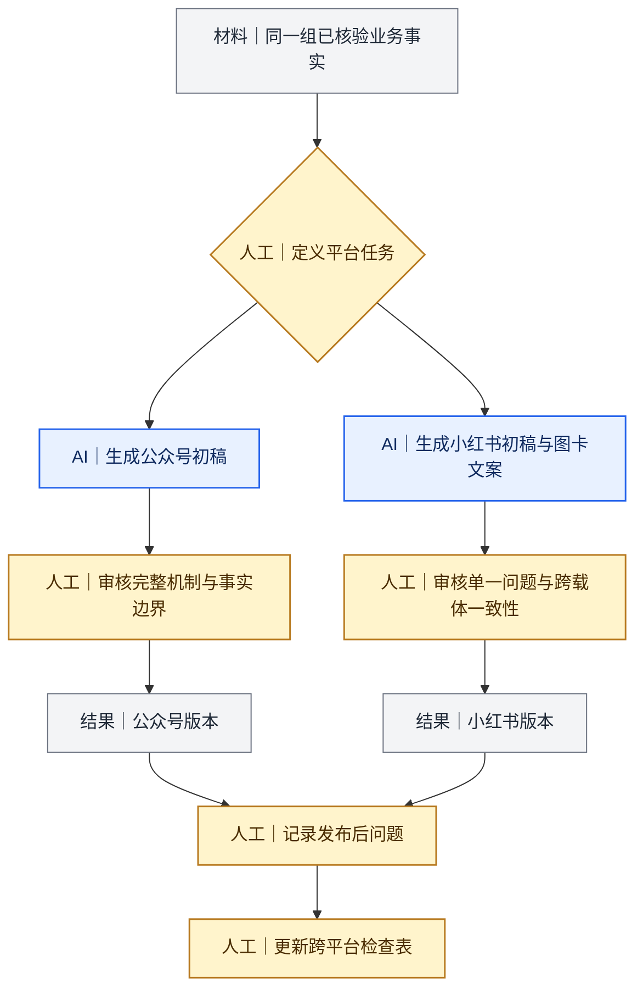
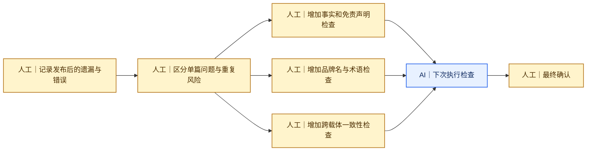

# 案例三：同一主题怎样适配公众号与小红书

[返回 Docs 导航](../README.md)

## 案例主题

我使用同一组已核验的Slickdeals业务事实，分别制作公众号文章和小红书图文，主题是：红人账号等级越高，是否代表发帖能力越强。

两个版本共享事实基础，但没有共用同一篇文章结构。

## 两个平台承担不同任务

| 项目 | 公众号版本 | 小红书版本 |
|---|---|---|
| 用户进入方式 | 已关注品牌或愿意深入了解 | 推荐流、搜索或问题触发 |
| 主要任务 | 完整解释等级、声望、Deal记录、品类和近期状态之间的关系 | 快速回答“等级越高是否越好”这一个问题 |
| 内容结构 | 背景、机制、案例对比、筛选清单和判断公式 | 短正文加7张信息卡 |
| 信息取舍 | 保留完整判断过程和条件 | 每张图只承担一个判断 |
| 人工审核 | 来源、术语、案例限制和结论 | 标题、正文、图卡和限制条件是否一致 |

## 小红书图卡怎样拆分

7张图卡分别承担：

1. 提出等级越高是否越强的问题；
2. 对比账号等级与声望值；
3. 区分Deal发布量与评论量；
4. 说明单帖表现不能代表整体能力；
5. 检查近期活跃状态；
6. 汇总筛选账号时需要同时查看的项目；
7. 形成“等级只能初筛，还要看具体表现”的总结。

图卡不是把公众号段落切成七份，而是围绕一个判断重新安排信息顺序。

## 发布后暴露的问题

复盘两个版本时，我发现：

- 小红书压缩内容时，部分限制条件被弱化；
- 公众号存在品牌名、英文拼写和语言审校问题；
- 单条首页帖或单个账号截图容易被误读为整体能力；
- 特殊账号身份可能影响案例解释，需要单独核对；
- 标题、正文、图片和评论回复需要使用同一口径。

## 我怎样把问题回写为检查项

检查表新增的重点包括：

- 核心结论和限制条件必须同时保留；
- 官方事实、第三方数据和个人判断需要区分；
- 单个案例不能扩大为整体规律；
- 品牌名、行业术语、数字、日期和单位前后一致；
- 标题、正文、图片和评论回复之间不能冲突；
- 公开截图需要处理头像、昵称和其他敏感信息。

## 证据说明

当前内部档案保留公众号正文、发布链接、本人提供的发布数据、小红书正文转录和页面截图。两个平台的观察时间、用户基数和指标定义不同，因此本案例不直接比较传播效果。

公开展示前，截图中的评论者头像和昵称需要再次遮挡或裁切。

## 延伸阅读

- [我怎样拆分任务并判断能否交给AI](../methods/02-task-decomposition.md)
- [我怎样记录版本并持续迭代](../methods/04-version-record-and-iteration.md)

