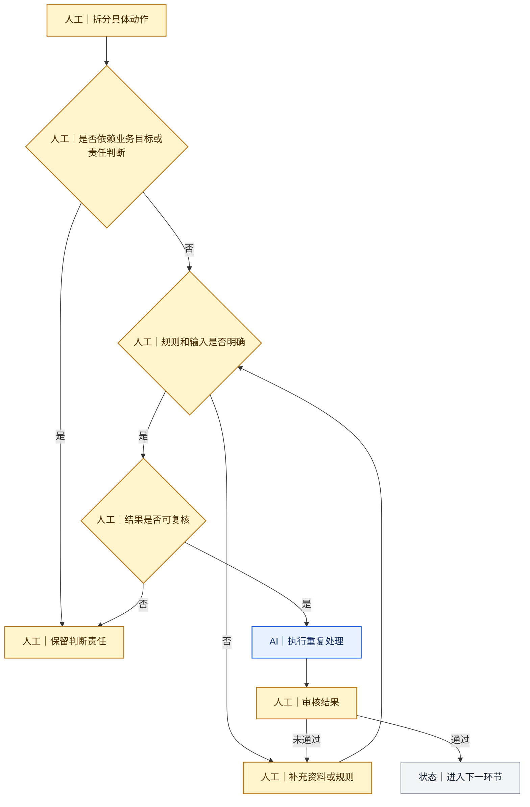

# 我怎样拆分任务并判断能否交给AI

[返回 Docs 导航](../README.md)

业务目标确定后，我会把任务拆成具体动作，再判断每个动作应由我完成、交给AI执行，还是由AI先处理后再由我审核。

我不会用“AI能不能做”作为唯一标准，还会判断：错误是否容易发现、后果是否可接受，以及我是否拥有足够的业务材料进行复核。

## 一、四个判断问题

| 判断问题 | 是 | 否 |
|---|---|---|
| 是否依赖经营目标、角色责任或服务承诺？ | 人工判断 | 继续判断 |
| 输入、规则和输出格式是否明确？ | 继续判断 | 人工补充资料与规则 |
| 结果能否通过来源、数据或清单复核？ | 可由AI辅助执行 | 保留人工处理 |
| 出错后能否在发布前被发现并修正？ | AI执行后人工审核 | 不进入自动化 |

## 二、在内容流程中的实际分工

| 环节 | AI可以辅助 | 我需要负责 | 审核重点 |
|---|---|---|---|
| 需求整理 | 归纳材料、列出问题和缺口 | 确认业务目标与优先级 | 有没有把表达任务当成业务目标 |
| 资料处理 | 抽取、分类、汇总和格式整理 | 判断来源、口径和冲突 | 事实是否可追溯 |
| 内容策划 | 提供多个大纲和结构方案 | 选择主线、重点与顺序 | 是否支持用户任务 |
| 内容生产 | 初稿、压缩、改写和格式转换 | 纠正业务角色、指标和承诺 | 文字正确不等于业务正确 |
| 平台适配 | 按平台规则重组内容 | 判断平台用户任务和账号身份 | 是否只是机械缩写 |
| 发布检查 | 术语、格式和一致性检查 | 事实、版权、隐私和风险确认 | 是否可以公开发布 |
| 数据整理 | 汇总指标和评论 | 解释数据与样本 | 不把相关性写成因果 |

## 三、我设置的人工审核点

审核点不是为了逐字重写，而是为了在返工成本扩大前确认方向、事实和责任。

## 四、不会交给AI自行决定的事项

- 内容服务于哪个经营目标；
- 用户真正需要完成的判断；
- 冲突资料中采用哪一项口径；
- 指标在具体业务流程中的含义；
- 服务条件、责任和承诺怎样表述；
- 未知信息是否可以公开；
- 最终版本是否发布。

## 相关案例

- [从一次文章Prompt到多平台内容能力体系](../cases/01-prompt-to-content-system.md)
- [Deal站投放知识库](../cases/02-deal-site-knowledge-base.md)

