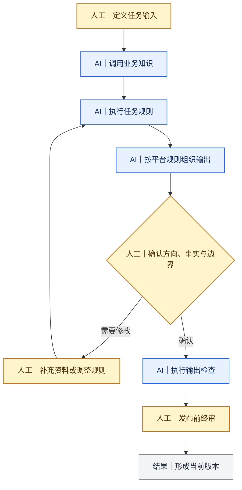
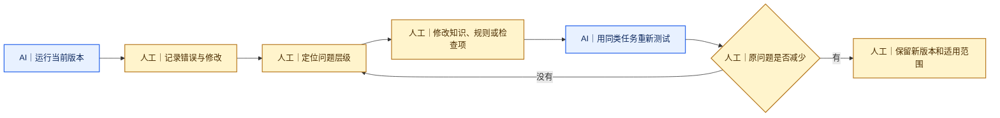

# 我怎样建设和调优自动化部分

[返回 Docs 导航](../README.md)

确定哪些步骤可以由AI处理后，我不会把所有要求继续堆进一份长Prompt，而是把业务知识、任务规则、平台规则和检查项分开维护。

这里的“自动化”主要指按照既定材料和规则重复执行，不表示完全无人参与或自动发布。

## 一、把自动化部分拆成六层

| 层级 | 需要写清的内容 | 解决的问题 |
|---|---|---|
| 任务输入 | 对象、目标用户、原始资料和交付形式 | 这一次具体要处理什么 |
| 业务知识 | 角色、流程、指标定义和服务边界 | AI怎样理解业务 |
| 任务规则 | 执行步骤、信息结构和禁止事项 | AI按什么顺序工作 |
| 平台规则 | 各渠道的阅读任务、结构和表达 | 同一事实怎样适配不同平台 |
| 人工确认点 | 大纲、正文、标题、视觉和发布审核 | 哪些节点必须停下来 |
| 输出检查 | 事实、术语、数据、隐私和一致性 | 怎样发现可重复错误 |

## 二、我怎样定位错误来自哪一层

| 现象 | 我检查的原因 | 调整位置 |
|---|---|---|
| AI误解业务指标 | 缺少指标产生过程、用途或限制 | 业务知识 |
| 文章方向偏离目标 | 扩写前没有确认主线 | 人工确认点 |
| 小红书版本只剩公众号摘要 | 只规定长度，没有定义平台任务 | 平台规则 |
| 压缩后结论和限制条件分离 | 跨载体检查不完整 | 输出检查 |
| 品牌名、术语或拼写不一致 | 缺少专项核对项 | 输出检查 |
| 每次都需要相同人工修改 | 重复问题没有回写 | 长期规则或Skill |

## 三、调优循环

## 四、判断是改单篇内容，还是改长期规则

| 问题类型 | 我的处理方式 |
|---|---|
| 一次性的文字或排版错误 | 只修改当前内容并记录 |
| 同类任务反复出现的问题 | 写入Prompt、Skill或检查表 |
| 业务角色、流程或指标误解 | 更新业务知识和参考文件 |
| 只在某个平台出现的问题 | 更新对应的平台规则 |
| 影响公开风险的问题 | 加入发布前强制审核项 |
| 尚未验证的调整 | 标记为待验证，不替换稳定规则 |

## 五、一次调优完成的最低记录

- 原任务与使用版本；
- 错误发生在哪一步；
- 人工修改了什么；
- 为什么修改；
- 修改进入哪一层规则；
- 用什么同类任务重新测试；
- 原问题是否减少；
- 新规则在哪些场景下适用。

## 相关案例

- [Deal站投放知识库](../cases/02-deal-site-knowledge-base.md)
- [同一主题适配公众号与小红书](../cases/03-cross-platform-content.md)

