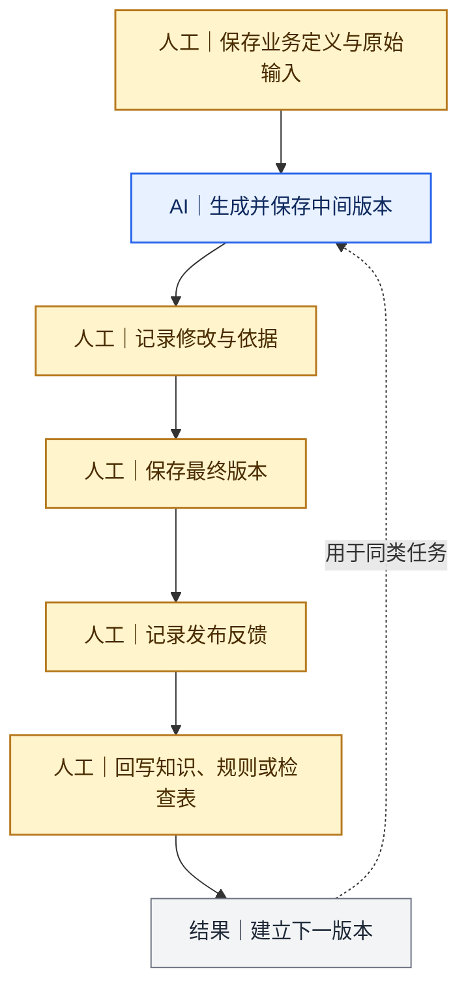

# 我怎样记录版本并持续迭代

[返回 Docs 导航](../README.md)

如果只保存最终稿，我无法追溯一个规则为什么出现，也无法判断新版本究竟解决了什么问题。因此，我会同时保存输入、过程、人工修改、最终版本和规则回写。

## 一、一条完整记录包含什么

| 记录对象 | 需要保存的内容 |
|---|---|
| 业务定义 | 目标用户、内容任务、发布平台和限制条件 |
| 原始输入 | 资料、来源、数据口径和已知缺口 |
| 使用版本 | Prompt、Skill、参考文件和版本号 |
| 中间过程 | 大纲、初稿、图片或平台转换版本 |
| 人工修改 | 改了什么、为什么改、依据是什么 |
| 最终交付 | 定稿、发布时间、链接或交付位置 |
| 反馈记录 | 原始指标、评论、用户问题和异常情况 |
| 规则回写 | 进入哪条Prompt、Skill、知识或检查表 |
| 待验证项 | 下一次需要继续观察什么 |



## 二、我的版本记录格式

```text
版本：
日期：
适用任务：
使用的输入与来源：
触发修改的问题：
人工修改内容：
修改依据：
影响的规则层：
重新测试的任务：
验证结果：
仍待确认：
```

## 三、怎样把反馈写回正确位置

| 发现的问题 | 回写位置 |
|---|---|
| 当前文章中的一次性错误 | 当前稿件修改记录 |
| 重复出现的语言或结构问题 | 通用写作规则 |
| 业务角色、流程或指标误解 | 业务知识与参考文件 |
| 平台信息顺序或载体不适配 | 平台规则 |
| 标题、正文和图片口径不一致 | 跨载体检查表 |
| 事实、版权、隐私或承诺风险 | 发布前审核清单 |
| 新发现但证据不足 | 待验证清单 |

## 四、我如何使用发布后的反馈

AI可以帮助汇总数据和评论，但我会保留三项人工判断：

1. 指标的统计时间、用户基数和定义是否一致；
2. 一条评论或一个案例能否代表更普遍的问题；
3. 反馈应该修改内容、规则、知识库，还是先继续观察。

不同平台的阅读、点赞、收藏、转发和评论不能直接横向比较。我只把它们作为对应版本的原始反馈，不把小样本扩大为长期因果结论。

## 五、版本进入稳定规则前的检查

- 同类问题是否至少再次出现或具有明显风险；
- 修改是否保留原有事实和限制条件；
- 新规则会不会误伤其他任务或平台；
- 是否已经用同类任务重新测试；
- 适用范围和不适用范围是否写清；
- 旧版本是否保留，能否回查修改原因。

## 相关案例

- [从一次文章Prompt到多平台内容能力体系](../cases/01-prompt-to-content-system.md)
- [同一主题适配公众号与小红书](../cases/03-cross-platform-content.md)

